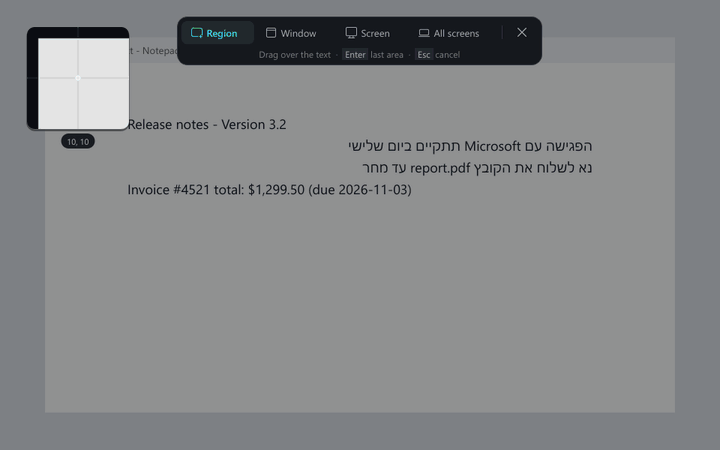
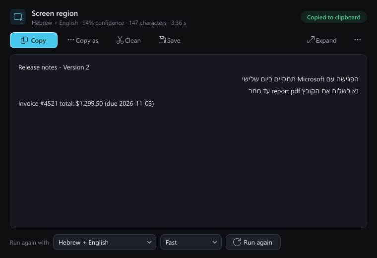
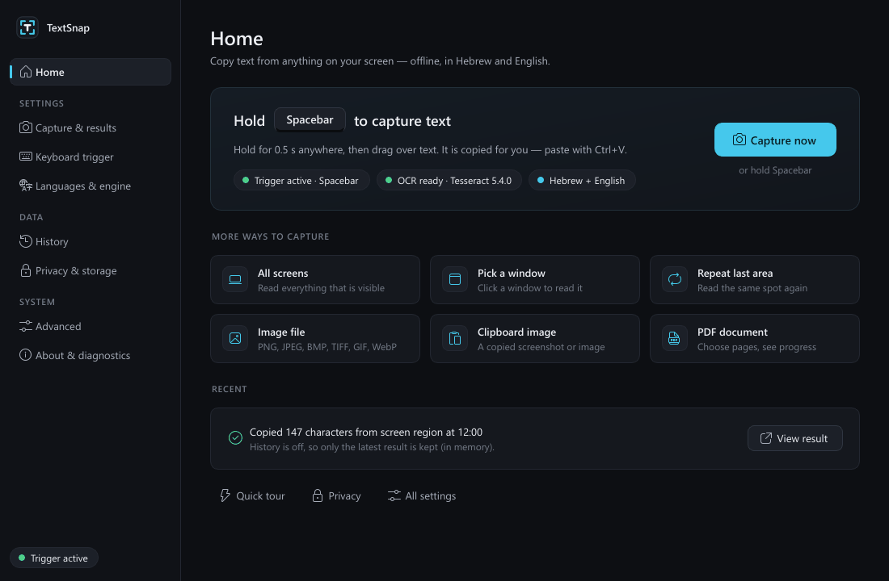

# TextSnap

Hold a key, drag over any text on your screen, paste it anywhere. A Windows tray utility with
**offline OCR for Hebrew, English and mixed Hebrew/English**.



<sub>Rendered offscreen from the real overlay and toast widgets: a synthetic screenshot is passed through the real
capture → OCR pipeline (bundled Tesseract), and the drag is simulated with Qt test events. Not a screen recording.</sub>

## Why

Text you can see but not select - error dialogs, images, videos, remote desktops, PDFs scanned as pictures - is
normally retyped by hand. Cloud OCR tools solve that but send your screen to a server, and most handle Hebrew
(right-to-left, often mixed with English) poorly. TextSnap does it entirely on your PC: no cloud, no account,
no network access, no telemetry.

## Features

- **Long-press trigger** (default: hold Spacebar 0.5 s; a normal tap still types a space) or any configurable key
  combination, plus tray menu and command-line triggers.
- **Freeze-frame overlay** across all monitors, correct for any DPI scaling and mixed-DPI layouts. Region, window,
  screen and all-screens modes, magnifier, repeat-last-area.
- **OCR**: Tesseract 5.4 with `tessdata_best` and `tessdata_fast` Hebrew + English models; fast and thorough
  (multi-preprocessing) modes; a mixed-script correction pass that re-reads words Tesseract misreads at
  Hebrew/English boundaries and fixes line order.
- **Results** go straight to the clipboard, with a non-focus-stealing toast and an editable result window
  (copy variants, clean text, run again with another language, save).
- **Other sources**: clipboard images, image files, PDFs (page ranges, embedded text when present), QR codes.
- **Opt-in history**, privacy controls, reduced-motion support, full keyboard navigation.

| Result window | Dashboard |
|---|---|
|  |  |

<sub>Offscreen renders of the real windows. The text in the result window is the bundled Tesseract's actual output
for the synthetic screenshot in the animation above, including its one mistake ("Version 3.2" read as "Version 2").</sub>

Full usage details (Spacebar behaviour, mixed-script handling, settings, privacy, troubleshooting, command line):
[docs/USER_GUIDE.md](docs/USER_GUIDE.md). Design decisions: [docs/DECISIONS.md](docs/DECISIONS.md).

## Tech stack

Python 3.11+ (developed and tested on 3.14) · PySide6 / Qt 6 · NumPy + Pillow for image preprocessing ·
Tesseract 5.4 run out of process (pixels piped in, TSV piped out, no temp files) · Win32 low-level keyboard hook
via `ctypes` · pypdfium2 (PDF) · zxing-cpp (QR) · PyInstaller for the packaged build · pytest + pytest-qt.

## Requirements

- Windows 10 or 11, 64-bit (the capture, hook and focus code is Win32-specific).
- Python 3.11+ to run from source.
- **Git LFS** to clone (see below). No separate Tesseract installation is needed.

### The bundled OCR engine

`vendor/tesseract` contains the official **UB Mannheim Windows build of Tesseract 5.4.0.20240606**, unmodified:

- `tesseract.exe` plus the 26 DLLs it imports (`libtesseract-5.dll`, `libleptonica-6.dll`, image codecs, compression
  and MinGW runtime libraries) - nothing else from the installer.
- Language models `eng` and `heb` from both `tessdata_best` (default, most accurate) and `tessdata_fast`, with the
  standard `configs` folder.
- `MANIFEST.json` records the SHA-256 of all 85 files; the app's self-test and the build verify against it.

These binaries and models (about 140 MB, 31 files) are stored with **Git LFS**.

## Clone

Git LFS is required; without it the engine files are small text "pointer" files and every OCR call fails
("OCR engine unavailable").

```bat
git lfs install
git clone https://github.com/fadlonerez-sketch/textsnap.git
cd textsnap
git lfs ls-files
```

`git lfs ls-files` should list 31 files under `vendor/tesseract` with `*` (content present), not `-` (pointer only).
If you cloned before installing Git LFS, run `git lfs pull`. To check the folder byte-for-byte:

```bat
python tools\prepare_vendor.py --verify
```

**Fallback without LFS:** `python tools\prepare_vendor.py` rebuilds `vendor/tesseract` from the official sources:
it downloads 7-Zip and the UB Mannheim installer from GitHub releases and the four models from the
`tesseract-ocr/tessdata_best` / `tessdata_fast` repositories, checks every download against a pinned SHA-256,
unpacks the installer with 7-Zip (nothing is installed), keeps only `tesseract.exe` and its DLL import closure, and
rewrites `MANIFEST.json`. It needs internet access and `pip install pefile`.

## Install and run (from source)

```bat
run.bat
```

`run.bat` creates `.venv`, installs the pinned `requirements.txt` on first run and starts TextSnap in the tray.
Hold Space for half a second, drag over text, press Ctrl+V. Equivalent manual steps:

```bat
py -3 -m venv .venv
.venv\Scripts\python -m pip install -r requirements.txt
.venv\Scripts\pythonw main.py
```

Use `--data-dir PATH` to keep a development instance's settings separate from your own.

**Portable build:** `build_exe.bat` produces `dist\TextSnap` (PyInstaller) and `dist\TextSnap-Portable` (runs on the
signed official Python runtime, for machines where Smart App Control blocks new unsigned executables). Both run their
self-test after building. See the [user guide](docs/USER_GUIDE.md#portable-builds-no-python-installation-needed).

## Tests

```bat
.venv\Scripts\python -m pip install -r requirements-dev.txt
.venv\Scripts\python -m pytest tests --ignore=tests/test_desktop.py
```

Result on the development machine (Windows 11, Python 3.14): **306 passed**. The tests run Qt offscreen and use the
real bundled Tesseract on synthetic, Qt-rendered Hebrew/English images; the keyboard trigger and clipboard are
replaced by fakes, and each test gets a temporary data folder.

`tests/test_desktop.py` injects real keyboard and mouse input. It is skipped unless `TEXTSNAP_DESKTOP_TESTS=1`
is set (`run_tests.bat --desktop`) and should only be run on a machine you are not using. Lint: `python -m ruff check .`
See [CONTRIBUTING.md](CONTRIBUTING.md).

## Project structure

```
main.py                 entry point
textsnap/keyboard/      trigger state machine, Spacebar hold-back, low-level hook thread
textsnap/capture/       DPI-aware monitor geometry, GDI screen snapshot, window rectangles
textsnap/ocr/           Tesseract subprocess engine, preprocessing, pipeline, mixed-script fix, PDF/QR
textsnap/app/           controller (workflow hub), job pool, single instance, self-test
textsnap/ui/            theme, motion, overlay, toast, result window, dashboard, dialogs
textsnap/winsys/        focus restore, autostart, optional paste
tests/                  pytest suite (offscreen) + opt-in desktop tests
tools/                  vendor preparation/verification, portable build, license collection, icon
vendor/tesseract/       bundled OCR engine and models (Git LFS)
```

## Known limitations

- Windows only.
- A region selection stays within one monitor (window, screen and all-screens modes cover several).
- Windows does not deliver key presses from elevated (administrator) windows to the trigger; the tray menu still works.
- Holding Space no longer auto-repeats while the Spacebar trigger is on, and apps that rely on a held Spacebar
  (games, push-to-talk, Space+drag panning) need the trigger paused or another key chosen. Details in the
  [user guide](docs/USER_GUIDE.md#the-spacebar-trigger).
- Accuracy depends on the source: screen text of 12 px or more reads reliably; very small serif or stylised text less so.
- Auto-detect chooses only between Hebrew and English.
- One dark theme; Windows light mode and High Contrast colours are not followed.
- Protected content (DRM video, secure desktop) captures as black, by Windows design.
- The vendored `libtesseract-5.dll` keeps the upstream debug information (~97 MB) so its publisher signature stays valid.

## License

TextSnap's own source code is released under the [MIT License](LICENSE).

The bundled Tesseract OCR engine, its language models and libraries, Qt/PySide6 and the other runtime components
are third-party software under their own licenses (Apache-2.0, BSD/MIT-style, LGPL, and GPL for two unmodified
helper DLLs used only by the separate `tesseract.exe` process). See [THIRD_PARTY_NOTICES.md](THIRD_PARTY_NOTICES.md),
`vendor/tesseract/licenses` and `packaging/licenses`.
